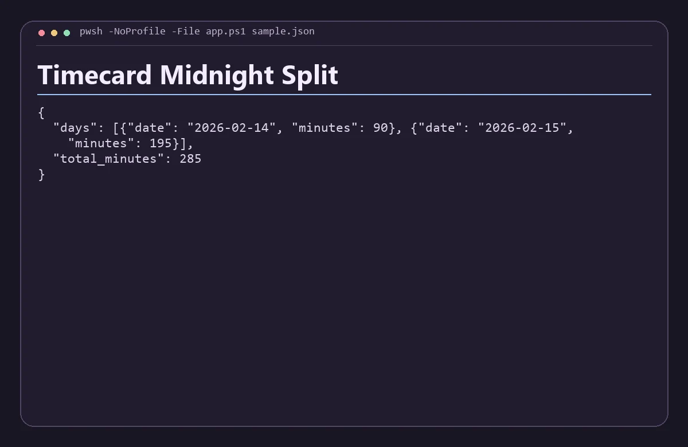

# Timecard Midnight Split

Split overnight shifts at calendar midnight and total the working minutes attributable to each date.



## Run

Install PowerShell 7 or newer. Run these commands from the repository root.

```sh
pwsh -NoProfile -File app.ps1 sample.json
```

Replace `sample.json` with a JSON file following the same structure. The app prints a JSON report to standard output.

Use local wall-clock timestamps in yyyy-MM-dd HH:mm format. Intervals include the start and exclude the end. Adjacent shifts are allowed. Overlaps are rejected to prevent double counting. The report measures clock minutes without daylight-saving adjustments.

## Verify

Run `python check.py` with Python 3.11 or newer after the build step when applicable. The check verifies the bundled scenario and confirms that an invalid input returns an error.
